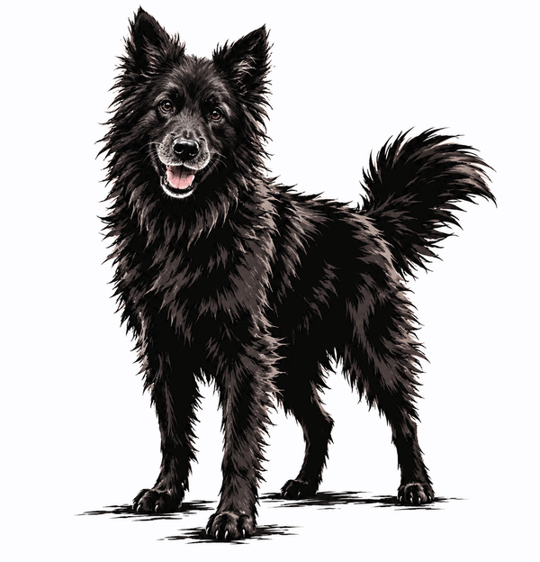

# Black Dog Island

<p align="center">
  
</p>

Верхняя панель для X11-рабочего стола в стиле Noctalia: остров по центру
экрана и выпадающий хаб с семью вкладками. Сделан под XFCE (xfwm4), экран
1366x768.

Композитинг нужен: прозрачные углы острова держит композитор xfwm4 (он
включён по умолчанию). Внешний `picom` не нужен и не ставится.

## Установка

Проверено: CachyOS (основная машина) и Void Linux в виртуалке — там
работали остров, хаб, погода, глифы и соты обоев после правок; смена темы
в виртуалке ещё тормозит. Arch, Manjaro и всё остальное **не проверялось**.

Поддерживается сеанс X11 + XFCE; остальные сеансы (Wayland, Hyprland)
установщик не трогает.

Скачать и проверить, чего не хватает:

```
git clone https://github.com/botanichk/black-dog-island
cd black-dog-island
./install.sh check
```

`check` только читает: ничего не устанавливает, пароль не спрашивает. Он
печатает готовую команду для недостающих пакетов — её надо выполнить самому,
потому что `sudo` есть только у владельца машины:

```
sudo xbps-install -S brightnessctl ImageMagick libpulseaudio NetworkManager
```

Потом одна команда — она соберёт движок, отключит панель Xfce и поставит
автозапуск:

```
./install.sh install
```

Сборка идёт 10–25 минут и занимает около 2 ГБ в `build/`. Подробно, с
проверками и откатом — в [docs/INSTALL.md](docs/INSTALL.md).

## Что внутри

- **Остров** 619x50 по центру верхнего края, резерв 50 px. Прячется только
  при полноэкранном окне (игры, фильмы) и возвращается сам.
- **Хаб** 619x358: Главная, Календарь, Погода, Wi-Fi, Снимок, Медиа, Цвета.
- **Темы**: палитры, светлая и тёмная схемы, цвета из обоев, сохранение
  своего вида.
- **Док и лаунчер**: если стоят Plank и Ulauncher, они красятся в цвета
  острова — см. [ниже](#plank-и-ulauncher).
- **Обои** выбором шестиугольниками, с размытым фоном и хуком под XFCE.
- **Таймер**, меню питания, трей, переключение раскладки.

## Plank и Ulauncher

Если у вас установлены **Plank** (док) или **Ulauncher** (лаунчер), они
автоматически красятся в тему острова — отдельных действий не нужно.
Происходит это при каждом запуске острова и при каждой смене темы:
остров пересобирает их файлы оформления из своих цветов.

- **Plank**: рамка дока берёт цвет акцента острова (`$primary`). Тем Plank
  на лету не перечитывает, поэтому док на секунду перезапускается.
  Исходная тема запоминается — `theme/plank.sh restore` её возвращает.
- **Ulauncher**: фон, рамка и подсветка активной строки в цветах острова.
  Перечитывает по сигналу, без мигания и без потери введённого текста.
  Вернуть исходное — `theme/ulauncher.sh restore`.

Если их нет — ничего не происходит: остров работает без дока и лаунчера,
перекрашивать нечего. `./install.sh check` покажет их в блоке «По желанию»
с готовой командой установки. Если поставите после установки острова —
тема подхватится при следующем запуске, автозапуск добавит
`./install.sh install` (повторный запуск безопасен, существующие записи
не перезаписываются).

## Как это устроено

Движок отрисовки собирается из исходников с нашими патчами: upstream не
подходит по версии и не умеет часть нужного (направление прокрутки, свой
Cairo-виджет спектра). Сборка идёт в `build/`, в репозиторий не попадает.

Закреплённый коммит движка: `48f5aa8` (тег-база `v0.6.0`, проверено
`git describe` -> `v0.6.0-91-g48f5aa8`). Исходники кладутся в
`build/eww-src` на этом коммите, затем `scripts/build-eww.sh` накладывает
`patches/*.patch`. Патчи идемпотентны: уже применённый откатывается и
накладывается заново.

```
eww/       конфиг окна: eww.yuck, eww.scss, assets/
adapters/  shell и C: данные панелей (погода, Wi-Fi, медиа, снимки, питание)
theme/     палитры, схемы, цвета с обоев, Plank, Ulauncher
lib/       общий код: установщик, откат, журнал изменений, проверка системы
scripts/   сборка движка, запуск и остановка острова
patches/   правки к движку, отдельными файлами
docs/      спеки, отчёты, доска задач
```

## Зависимости

Ставить руками не нужно: `./install.sh check` скажет, чего не хватает, и
напечатает готовую команду для Arch (`pacman`) или Void (`xbps-install`).
Проверяются команды, а не имена пакетов, — таблицы `deps/arch.txt` и
`deps/void.txt` в формате `команда | пакет | обязательна | зачем`.

Без части пакетов интерфейс не падает, но врёт молча: без `nmcli` Wi-Fi
показывается как «отключено», без `pactl` громкость равна нулю. Подробности
и точные замеры - в `docs/BDI-FACTS.md`.

## Запуск

```
scripts/build-eww.sh      # собрать движок с патчами (долго, нужен Rust)
scripts/run-island.sh     # открыть остров по центру
scripts/stop-island.sh    # закрыть
```

Эти команды нужны, если ставишь вручную, без `install.sh`. После
`./install.sh install` остров запускается сам при входе.

Когда в репозитории появились новые коммиты, обновление одной командой:

```
./install.sh update
```

Она делает `git pull`, пересобирает движок только при смене его коммита или
патчей и перезапускает остров.

## Откат

Если что-то пошло не так — вернуть систему в прежнее состояние:

```
./install.sh uninstall          # по журналу: панель XFCE, композитинг, автозапуск
./install.sh --restore-backup   # вернуть каталоги из резервной копии целиком
```

Обе команды работают **без графики**: из Hyprland, из текстовой консоли
(`Ctrl+Alt+F2`), по ssh. Пошагово, если панель XFCE пропала, —
[docs/TESTING.md](docs/TESTING.md#4-откат).

## Известные пробелы

- Вкладка Wi-Fi не умеет подключаться к новым сетям (только сохранённые).
- Часть настроек ввода движка в этой сборке не работает, объяснения стоят
  отдельными подписями.
- Разрешение экрана рассчитано на 1366x768: на другом экране не проверялось.

## Состояние

Проект в работе, интерфейс меняется. Доска задач и журнал - в
`docs/TASKS.md`, отчёт аудита - в `docs/AUDIT-2026-11-20.md`.

## Источники цветов

Цвета взяты из [Noctalia](https://github.com/noctalia-dev/noctalia) (лицензия
MIT, `Copyright (c) 2026 noctalia-dev`). Десять встроенных палитр лежат в
`theme/palettes/*.json` без правок — из `builtin_palettes.cpp` тега `v5.4.1`;
цвета с обоев считает `noctalia theme`.

Подробности: какие палитры, почему не указаны авторы схем, почему палитры
сообщества не копируются в репозиторий — в
[docs/THEME.md](docs/THEME.md#откуда-цвета-и-лицензии).

## Лицензия

MIT, см. `LICENSE`.
